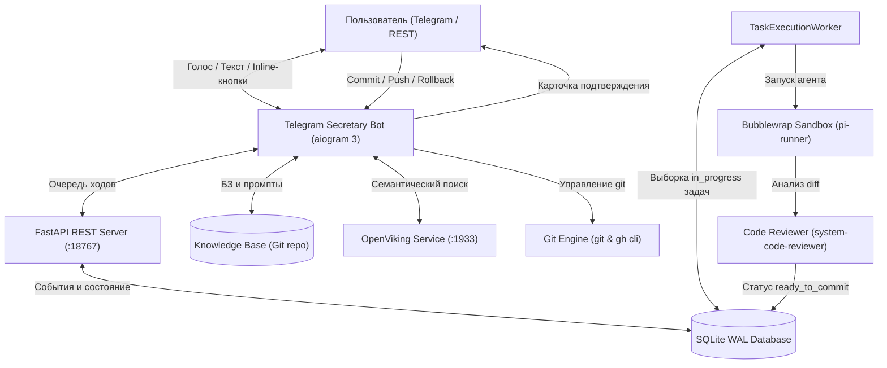

# Архитектура Agent Manager

Agent Manager представляет собой автономную распределенную систему оркестрации ИИ-агентов, ориентированную на решение инженерных задач с контролем качества и интерактивным интерфейсом через Telegram.

---

## 1. Общая схема компонентов

---

## 2. Ключевые модули

### 2.1. Хранилище (Storage & Database)
- SQLite WAL с `busy_timeout = 5000ms` и внешними ключами (`foreign_keys = ON`).
- Таблицы:
  - `tasks`: задачи, их метаданные, статусы, очереди и выбранный `agent_id`.
  - `conversations`: треды диалогов.
  - `messages`: реплики пользователя и ассистента.
  - `turns`: пошаговые ходы с защитой от одновременных запусков.
  - `agent_profiles`: иммутабельные версии профилей с optimistic concurrency control (`expected_revision`).
  - `conversation_runtimes`: привязка диалогов к сессиям рантайма.

### 2.2. Сервер API (FastAPI)
- Слушает только `127.0.0.1:18767`.
- Предоставляет OpenAPI схемы и REST-интерфейс для Telegram-бота, внешних агентов и административных скриптов.

### 2.3. TaskExecutionWorker & Изоляция Воркскейсов

- Исполнитель выбирается из `task.agent_id`, затем из настройки worker для старых задач без назначения.
- Workspace разрешается одинаковым механизмом в preflight API и worker; отсутствующий явно заданный каталог вызывает ошибку, а не переход к другому проекту.
- Runtime и модель выбираются общим механизмом с диалогами; режим доступа берётся из профиля выбранного агента.

- Фоновый демон с пулом рабочих очередей.
- Изоляция воркспейсов: гарантирует, что в одном git-репозитории одновременно выполняется не более одной задачи.
- Поддерживает фазы:
  1. Выполнение задачи разработчиком (`agent-manager-developer` или специализированный проектный агент).
  2. Автономное Code Review (`system-code-reviewer`) до 3 раундов.
  3. Переход в статус `ready_to_commit`.

### 2.4. Git Engine
- Инкапсулирует безопасные операции с git:
  - `commit_local`: стадирование **только явно измененных файлов** (`git add -- <files>`), без `git add .`.
  - `rollback`: безопасная очистка рабочего дерева и откат незакоммиченных изменений.
  - `commit_and_push`: пуш ветки и мониторинг GitHub Actions CI через `gh run watch` с получением логов упавших шагов.

### 2.5. Секретарь и голосовой интерфейс (Telegram Bot)
- Режим Talk и Task.
- Автоматическая транскрипция голосовых сообщений (Deepgram ASR) с явным маркированием для нейросети:
  `[Голосовое сообщение (автоматическая расшифровка речи, возможны неточности распознавания)]:\n<текст>`
- Интерактивные карточки подтверждения коммитов с inline-кнопками.
