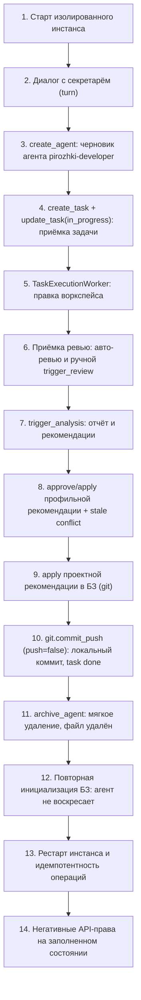

# Спецификация и статус E2E-тестирования полного жизненного цикла платформы («Пирожки»)

## 🎯 Цель
Автоматизированный сквозной прогон всей цепочки взаимодействия Agent Manager на изолированном тестовом инстансе (без боевого Telegram-бота, продакшн-БД и рабочих проектов).

Реализовано в детерминированном виде в `tests/test_e2e_pirozhki.py` на реальных
компонентах: мигрированная временная SQLite, временные git-репозитории базы
знаний и проекта, реальные `QueueDispatcher`, `TaskExecutionWorker`,
`OperationWorker` и эфемерный HTTP-backend (`uvicorn`, случайный loopback-порт).
Дочерние исполнения — детерминированный `tests/fake_pi_runner.py`; реальные
JavaScript-инструменты `src/pi_runner/policy.mjs` запускаются Node против того
же backend (`tests/e2e_pirozhki_tools.mjs`). Ни один тест не подменяет результат
прямой вставкой в БД.

---

## 🏗 Архитектура тестового стенда

1. **Изоляция окружения:**
   * **Порт API:** эфемерный loopback-порт (`127.0.0.1:0`).
   * **База данных:** временный файл SQLite, мигрированный реальной цепочкой Alembic.
   * **База знаний (Git):** временный каталог с `git init`, реальные коммиты.
   * **Воркспейс проекта:** временный git-репозиторий `pirozhki-shop`.
   * **Артефакты/состояние:** временные каталоги инстанса.
   * **Runner:** детерминированный `fake_pi_runner.py`; опциональный реальный
     `pi_runner` включается только по `AGENT_MANAGER_REAL_MODEL_E2E=1`.

2. **Клиент взаимодействия:**
   * HTTP-клиент к эфемерному API (`/conversations`, `/turns`, `/tasks`,
     `/operations`, `/agents`, `/analysis`, `/recommendations`).
   * Реальные JS-инструменты платформы против того же backend.

---

## 📋 Сценарий сквозного тестирования (шаги)

### Подробное описание этапов:

1. **Поднятие стенда:**
   * Реальная миграция временной БД, `git init` базы знаний, инициализация
     базовых профилей (`system-secretary`, `system-code-reviewer`,
     `system-log-analyzer`) через `KnowledgeBase.initialize`.
   * Эфемерный uvicorn-backend и проверка `/health`.

2. **Диалог с секретарём:**
   * Тестовый клиент создаёт разговор, добавляет сообщение и очередь `/turns`.
   * `QueueDispatcher.step()` прогоняет ход через реальный
     `PersistentConversationHandler` и дочерний Runner; статус хода —
     `completed`, ответ секретаря сохранён.

3. **Создание агента с подтверждением черновика:**
   * Инструмент `create_agent` создаёт `pirozhki-developer` ревизии 1.
   * Повторный `create_agent` с тем же `agent_id` возвращает `409`: черновик
     не перезаписывается молча.

4. **Приёмка задачи:**
   * Инструмент `create_task` создаёт задачу с явными `workspace`/`agent_id`
     (предварительная проверка `/workspaces/resolve` обязательна).
   * `update_task(status="in_progress")` авторизует исполнение.

5. **Исполнение воркером:**
   * `TaskExecutionWorker.step()` монтирует точный воркспейс; детерминированный
     дочерний Runner вносит реальную правку в рабочее дерево.
   * После авто-ревью задача переходит в `ready_to_commit`; сохраняются
     `execution_context`, `summary`, `changed_files`, провенанс сессии.

6. **Приёмка ревью:**
   * Автоматический цикл ревью в исполнении разработчика формирует отчёт и
     вердикт.
   * Отдельный `trigger_review` запускает независимое ревью завершённой задачи
     без перезапуска разработчика. Точный повтор вызова (тот же toolCallId)
     идемпотентен, новый намеренный вызов создаёт новую операцию.

7. **Анализ сессии:**
   * `trigger_analysis` запускает `system-log-analyzer` через штатный
     `default_analyzer_runner`. Формируется отчёт с ограниченным свидетельством
     (`evidence`) и рекомендации, привязанные к цели и наблюдаемой ревизии.

8. **Утверждение рекомендаций:**
   * `preview_recommendation` → `approve_recommendation` →
     `apply_recommendation` для профиля: ревизия профиля увеличивается, а
     Git-экспорт `agents/pirozhki-developer.md` обновляется, поэтому следующий
     sync не откатывает одобренное изменение.
   * Устаревшая рекомендация (цель изменилась после генерации) возвращает
     `409`, сохраняется статусом `conflict`, новое содержимое не затирается.

9. **Обновление базы знаний:**
   * `apply_recommendation` для проекта обновляет
     `projects/pirozhki-shop/summary.md` и коммитит изменение в git БЗ.

10. **Локальный коммит:**
    * `git.commit_push(push=false)` фиксирует только явные `changed_files`,
      возвращает `commit_hash` и переводит задачу в `done`.

11. **Архивация:**
    * `DELETE /agents/pirozhki-developer` (soft-delete) помечает профиль
      `archived`, удаляет `agents/pirozhki-developer.md` и коммитит удаление.

12. **Отсутствие воскрешения:**
    * Повторная `KnowledgeBase.initialize` читает файлы и экспортирует только
      активные профили: архивированный агент остаётся архивированным.

13. **Рестарт и идемпотентность:**
    * Инстанс пересобирается на той же БД: разговоры, сообщения, задачи и
      операции сохраняются.
    * Повторный `POST /operations` с тем же `idempotency_key` возвращает `200`
      и ту же операцию; осиротевшая `running`-операция переводится в
      `interrupted` без повторного проигрывания.

14. **Негативные права:**
    * На заполненном состоянии execution-scoped токены не могут читать чужую
      задачу, перечислять коллекцию или выполнять несогласованные действия
      (`review`-грант не может отправить git-операцию), а запрос без токена
      получает `401`.

---

## 🧪 Опциональная проверка реальной моделью

`tests/test_e2e_real_model.py` по умолчанию пропускается. При
`AGENT_MANAGER_REAL_MODEL_E2E=1` он поднимает тот же изолированный инстанс с
реальным `pi_runner` и штатным разрешением провайдера/модели из host-настроек
через обычные механизмы, затем прогоняет один ход секретаря. Тест не читает и
не сохраняет учётные данные, не обращается к production Telegram/API/данным. При
отсутствии рабочего рантайма/модели фиксируется фактическая диагностика, а не
синтетический успех.

---

## ⏱ Статус
* **Детерминированный E2E:** реализован и проходит
  (`tests/test_e2e_pirozhki.py`).
* **JS-инструменты:** прогоняются реальной `policy.mjs`.
* **Опциональный реальный прогон:** гейт присутствует; выполняется только по
  явному включению и не входит в обычный прогон.
