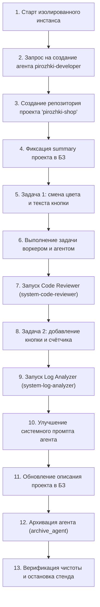

# Спецификация E2E-тестирования полного жизненного цикла платформы («Пирожки»)

## 🎯 Цель
Автоматизированный сквозной прогон всей цепочки взаимодействия Agent Manager на изолированном тестовом инстансе (без задействования боевого Telegram-бота, продакшн-БД и рабочих проектов).

---

## 🏗 Архитектура тестового стенда

1. **Изоляция окружения:**
   * **Порт API:** Эфемерный или выделенный тестовый (например, `18799`).
   * **База данных:** Временный файл SQLite (`/tmp/agent_manager_e2e_test/tasks.db`).
   * **База знаний (Git):** Временный каталог `/tmp/agent_manager_e2e_test/knowledge/` с инициализированным git-репозиторием.
   * **Воркспейсы и артефакты:** `/tmp/agent_manager_e2e_test/workspaces/` и `/tmp/agent_manager_e2e_test/artifacts/`.
   * **Политика и песочница:** Использование тестового Pi runner с изолированным Bubblewrap монтированием.

2. **Клиент взаимодействия:**
   * Тонкий тестовый HTTP-клиент, эмулирующий запросы Telegram-бота (через эндпоинты `/conversations/{id}/messages` и `/conversations/{id}/turns`).

---

## 📋 Сценарий сквозного тестирования (Шаги)

### Подробное описание этапов:

1. **Поднятие стенда:**
   * Запуск FastAPI + Dispatcher + TaskWorker на тестовой конфигурации.
   * Проверка эндпоинта `/health` и базовых агентов (`system-secretary`, `system-code-reviewer`, `system-log-analyzer`).

2. **Создание агента (`create_agent`):**
   * Пользователь (тестовый клиент) пишет Секретарю: *«Создай агента pirozhki-developer для сайта по продаже пирожков, инструменты read, write, edit, bash»*.
   * Проверка: агент появился в `agent_profiles` и в файле `knowledge/agents/pirozhki-developer.md`.

3. **Инициализация проекта:**
   * Создание тестового git-репозитория `/tmp/agent_manager_e2e_test/workspaces/pirozhki-shop` с простым приложением (HTML/CSS/JS или FastAPI с каталогом пирожков).

4. **Фиксация проекта в Базе Знаний (`save_project_summary`):**
   * Секретарь сохраняет `projects/pirozhki-shop/summary.md`. Проверка git-коммита в БЗ.

5. **Задача 1 (UI-правка):**
   * Секретарь ставит задачу в очередь: *«Поменять дизайн кнопки заказа: сделать её зелёной с текстом 'Заказать горячий пирожок'»*.
   * Воркер подхватывает задачу, изолированно монтирует воркспейс в sandbox, агент выполняет редактирование файла.
   * Статус задачи переходит в `ready_to_commit` / `done`.

6. **Код-ревью (`trigger_review`):**
   * Запуск агента `system-code-reviewer`.
   * Проверка генерации отчёта ревью в артефактах задачи и валидации git diff.

7. **Задача 2 (Функциональная доработка):**
   * Постановка задачи: *«Добавить кнопку 'Пирожки с капустой' и счётчик заказа»*.
   * Агент вносит изменения, воркер завершает задачу.

8. **Анализ сессий (`trigger_analysis`):**
   * Запуск `system-log-analyzer` по выполненным задачам.
   * Анализатор формирует рекомендации по оптимизации промпта или проектных правил.

9. **Эволюция промпта и базы знаний (`update_agent`, `write_knowledge`):**
   * Обновление промпта `pirozhki-developer` на основе замечаний анализатора.
   * Обновление саммари проекта актуальными точками входа.

10. **Архивация агента (`archive_agent` / `DELETE /agents`):**
    * Проверка soft-delete механизма: агент получает флаг `archived: True`.
    * Файл `knowledge/agents/pirozhki-developer.md` удаляется и коммитится.
    * Рестарт синка: убедиться, что удалённый агент не воскресает.

11. **Очистка стенда:**
    * Корректная остановка сервиса и удаление временных файлов `/tmp/agent_manager_e2e_test`.

---

## ⏱ Статус
* **Статус:** Сохранено в бэклог для последующей реализации по команде пользователя.
